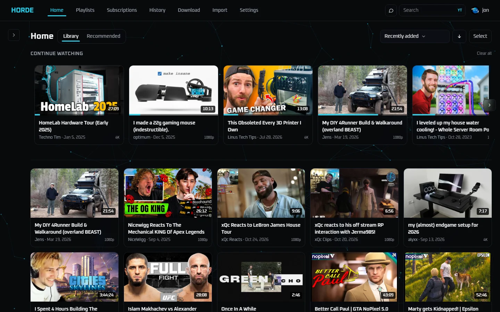
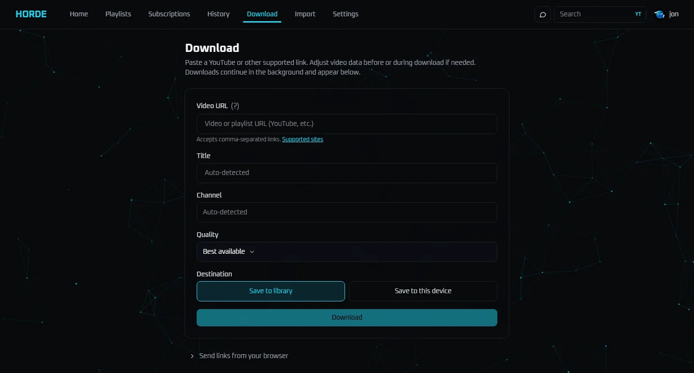
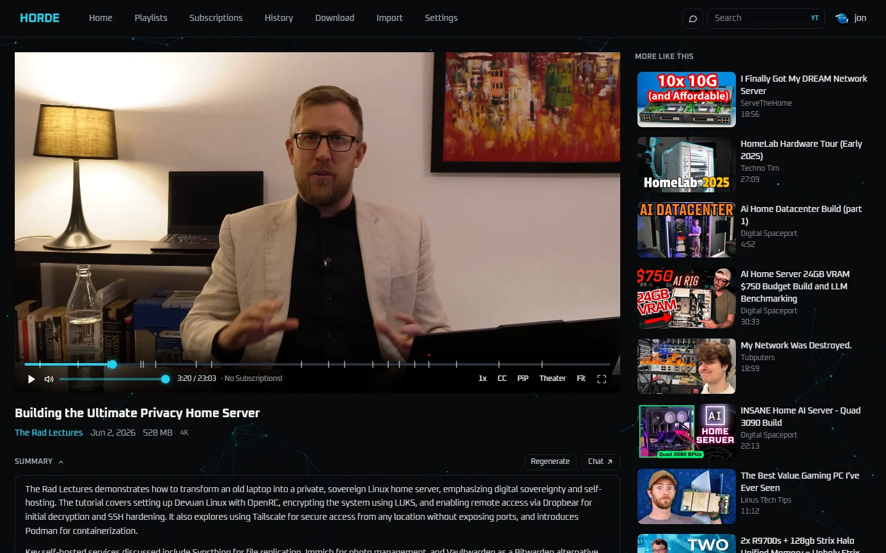

# Horde

[](https://github.com/jm-connell/horde/releases/latest)
[](https://github.com/jm-connell/horde/actions/workflows/ci.yml)
[](https://github.com/jm-connell/horde/pkgs/container/horde)
[](https://jm-connell.github.io/horde/)
[](LICENSE)
[](https://github.com/sponsors/jm-connell)

Horde is a self-hosted media archive, downloader and player. It builds on
yt-dlp, SponsorBlock, FFmpeg and other great projects ([Built with](#built-with))
to give you a full-featured, private video platform on your own hardware.
Horde started as an archive, and now also supports streaming from YouTube
without downloading, live streams included. Nearly everything is adjustable in
Settings.

It's built for a household, not just one person: one administrator plus member
accounts, each with their own watch history, recommendations, AI chats and
appearance. The admin decides what each member may do, such as download,
delete or use AI.

One of Horde's core (but optional) features is AI, either a local model on
your own hardware or a cloud provider such as OpenRouter. It powers video
summaries and chat, smart search across your whole library and the channels you
follow, a transparent and tunable recommendation feed, and more.

## Why Horde

I've used Plex for years and still use it almost every day. It's great for
movies and TV, but it falls short on "Other" videos: the organization isn't
great, and an archive of YouTube-style videos is hard to navigate. Horde gives
you an interface closer to YouTube (better, in my biased opinion), so your
archive is easy to get around, whether you import an existing library or
download into Horde from the web UI with yt-dlp.

I've spent a huge amount of time on Horde since I started it in June 2026, and
I'm very happy with where it is. I want it to be useful to as many people as
possible, so please send feedback: bugs, missing features, or anything else it
needs. Horde is still under active development and my first priority is making it polished and accessible, so feedback is appreciated.

Horde is free and source-available. If you enjoy it and want to support its
development, please consider [sponsoring me on GitHub](https://github.com/sponsors/jm-connell).

---

Horde is a single Docker container: a FastAPI backend that serves the React UI,
the API and an offline copy of the documentation. Docker Compose also starts a
small [bgutil POT](https://github.com/Brainicism/bgutil-ytdlp-pot-provider)
container that helps YouTube downloads work without a Google login. A bundled
Ollama container for local AI is optional. Horde is built for TrueNAS with
Dockge and runs on any Linux Docker host.

Documentation: [jm-connell.github.io/horde](https://jm-connell.github.io/horde/),
or **Settings → System → Documentation** (`/wiki/`) in a running Horde.
Interactive API reference: `/docs`.

## Features

- **Downloads**: paste any yt-dlp-supported URL, pick a quality preset, and
  follow a queue with live progress, pause and resume. Imports whole YouTube
  playlists.
- **Files on disk**: saved as `Channel/Year/Title [id].ext`, so browsing the
  share over SMB matches the UI.
- **Import**: upload in the browser, or copy `.mp4` / `.mkv` / `.webm` files
  into the media folder. New files wait in a review queue before joining the
  library.
- **Library**: channel sidebar, hybrid search, tags, bulk selection, continue
  watching, and YouTube channel catalogs to browse, preview and download
  uploads you don't have yet.
- **Recommended**: a home feed for when you don't know what to watch: new
  uploads from your channels, more like what you've been watching, channels
  you've never seen (found on YouTube in the background, gently rate limited)
  and the odd throwback, with "not interested" and channel suggestions.
- **Comments**: the top YouTube comments of every video, with the most
  popular discussions' replies, are saved with it, show under the video,
  count in search and tell Ask what viewers thought. More load from YouTube
  on request.
- **Player**: standard, theater and windowed modes, mini player,
  picture-in-picture, Chromecast, AirPlay, SponsorBlock, chapters and
  subtitles. Videos play as stored, without live transcoding; devices that
  cannot play AV1 can get an H.264 copy made ahead of time (Playback
  compatibility, Settings → Library).
- **YouTube streaming**: preview a video before deciding to download it. Works
  for most videos, but quality varies and it can break when YouTube changes.
- **Live streams**: follow channels, see which are live in the sidebar, and
  watch with rewind (4 hours by default).
- **Playlists**: your own lists, imported YouTube playlists, or subscribed
  playlists that pick up new videos as they are added.
- **YouTube history**: import your watch history, subscriptions and playlists
  from Google Takeout to mark what you have seen and shape recommendations.
- **Installed app and offline**: install Horde to a phone's home screen and
  save videos to the device to watch without a connection (needs HTTPS).
- **Accounts**: one administrator plus members, each with their own watch
  history, AI chats and appearance; members get only the permissions the admin
  grants. Optional two-step sign-in.
- **AI** (optional): summaries, chapters, tags, semantic search, related
  videos and sharper recommendations, with any OpenAI-compatible provider
  (OpenRouter, OpenAI, Gemini, Groq, Ollama, LM Studio, …).
- **Ask**: one chat at the bottom of every page that answers about Horde
  itself (how-to, finding and changing settings, your own library, custom
  CSS), about the video you are watching, or about what YouTube channels said
  in their videos. Channels are indexed from their captions, with no
  download; the search bar finds every moment that mentions your words, and
  a question such as "What does The Car Care Nut say about the 2004 4Runner?"
  gets an answer that cites each point with a link to the moment it was said
  and compares channels that disagree. Searching works without AI; asking
  needs a chat model.

Horde is meant for a home network or VPN. Everyone signs in, but before
exposing it to the internet, follow the
[internet exposure checklist](https://jm-connell.github.io/horde/ops/internet-exposure/).
See [Accounts and sign-in](https://jm-connell.github.io/horde/ops/authentication/),
including how to reset a lost admin password.

## Screenshots







## Quick start

Full walkthroughs: [Install with Docker](https://jm-connell.github.io/horde/getting-started/install-docker/)
and [TrueNAS / Dockge](https://jm-connell.github.io/horde/getting-started/truenas-dockge/).

### Requirements

- 64-bit Linux host with Docker, the Docker Compose plugin (`docker compose
  version` reports v2 or newer) and Git.
- Run all commands in a shell on the host (SSH or the TrueNAS shell), not in
  Dockge's per-container **Bash** button.
- If Docker reports `permission denied`, prefix `docker` commands with `sudo`.

### 1. Clone

Compose downloads the published image (`ghcr.io/jm-connell/horde`, x86 and
ARM); the checkout holds the compose file, `.env.example` and `update.sh`. Use
`git clone`, not a ZIP, so `update.sh` can update it later.

```bash
git clone https://github.com/jm-connell/horde.git
cd horde
```

TrueNAS / Dockge: clone into the Dockge stacks folder so the folder name is the
stack name. Do not use **Add Stack** with only `docker-compose.yml`; the build
needs the whole repo.

```bash
cd /mnt/tank/dockge/stacks          # your DOCKGE_STACKS_DIR
git clone https://github.com/jm-connell/horde.git horde
cd horde
```

### 2. Create folders

Create a media folder and a data folder outside the repo, owned by the user
Horde should write files as (`id -u` / `id -g`):

```bash
mkdir -p /home/you/horde-media /home/you/horde-data
sudo chown -R 1000:1000 /home/you/horde-media /home/you/horde-data
```

### 3. Configure

```bash
cp .env.example .env
```

Set these in `.env`:

| Variable | Value |
|----------|-------|
| `PUID` / `PGID` | Output of `id -u` / `id -g` (TrueNAS: Credentials → Local Users). Not `0`. |
| `DOWNLOADS_PATH` | Full path of the media folder. May be a network share. |
| `DATA_PATH` | Full path of the data folder (database, thumbnails). Must be a local disk, not SMB/NFS: SQLite can corrupt on network filesystems. |

The example values are TrueNAS paths. On other machines Docker creates missing
paths owned by root, and Horde cannot save downloads there. Keep paths in
`.env`, not in `docker-compose.yml`. Leave `HORDE_IMAGE` as it is: it points
at the published image. (Comment it out to build from source instead.)

### 4. Start

```bash
docker compose up -d
```

Dockge: menu → **Scan Stacks Folder**, open `horde`, **Deploy**. Do not edit
the volume lines in the compose editor. The first start downloads about 1 GB.

### 5. Open

Go to `http://<server-ip>:8686` (host port 8686, not 8080), create the admin
account and complete the setup wizard. To verify: `docker compose ps` shows
`horde` as `Up (healthy)`, and `curl -s http://127.0.0.1:8686/api/health`
returns `"status":"ok"`. Common errors:
[troubleshooting table](https://jm-connell.github.io/horde/getting-started/install-docker/#if-something-goes-wrong).

### Optional

- **Imports:** `.mp4` / `.mkv` / `.webm` files copied into the media folder
  (for example over SMB) appear in **Import** within `SCAN_INTERVAL_SEC`
  (default 60s).
- **AI:** choose a provider in the setup wizard or Settings → AI (any
  OpenAI-compatible URL, plus an API key if required). For local models without
  your own server, run `docker compose --profile ai up -d` and choose "Run
  Ollama for me". Docker networking: [AI setup](docs/ops/ai-setup.md).
- **GPU or a different port:** put these in `docker-compose.override.yml` next
  to `docker-compose.yml`. Compose reads it automatically and updates do not
  touch it. See [GPU](https://jm-connell.github.io/horde/ops/environment/#gpu)
  and [Change the port](https://jm-connell.github.io/horde/ops/ports-networking/#change-the-port).

## Update

The **Update now** button in **Settings → System → Updates** updates Horde from
the browser. It needs a one-time setup: a cron job on the host that runs
`scripts/update_watch.sh` every minute as root (TrueNAS: System → Advanced
Settings → Cron Jobs). Horde itself never gets access to Docker; the button
leaves a request that the cron job picks up. Steps:
[Updating](https://jm-connell.github.io/horde/getting-started/updating/#update-from-the-app).

From a shell on the host, the same update is:

```bash
cd /path/to/horde          # e.g. /mnt/tank/dockge/stacks/horde
bash update.sh
```

Either way, `update.sh`:

- backs up the database,
- moves to the newest release (set `HORDE_UPDATE_CHANNEL=main` in `.env` to
  follow every commit instead; that needs a build from source),
- pulls the new image (or rebuilds it, when building from source), recreates
  the containers and waits until Horde reports healthy,
- rolls back automatically if the new version does not start.

`bash update.sh --rollback` undoes the last update. Videos and settings are not
affected. After an update, hard-refresh the browser (`Ctrl+Shift+R`). On
Dockge, reload the page instead of clicking **Deploy**: the script has already
recreated the stack.

Do not run `git reset --hard` or edit `docker-compose.yml` to get past a failed
update; see [Updating](https://jm-connell.github.io/horde/getting-started/updating/)
for what to do instead. Installs from before the published image build on the
host until `HORDE_IMAGE` is set
([Use the published image](https://jm-connell.github.io/horde/getting-started/updating/#use-the-published-image)).

yt-dlp is pinned in the image and updates with Horde. To install the newest
yt-dlp on every container start instead, set `YTDLP_AUTO_UPDATE=1` in `.env`.

## Configuration

Settings that live in `.env` (most others are in the app's Settings page):

| Variable | Purpose |
|----------|---------|
| `PUID` / `PGID` | User and group Horde writes files as (default `1000`) |
| `DOWNLOADS_PATH` | Host folder for videos, mounted at `/downloads` |
| `DATA_PATH` | Host folder for the database and thumbnails, mounted at `/app/data` (local disk only) |
| `HORDE_IMAGE` | Image to run (default: the published `ghcr.io/jm-connell/horde:latest`; comment out to build from source) |
| `SCAN_INTERVAL_SEC` | How often the media folder is rescanned for new files (default `60` seconds) |
| `HORDE_LIVE_POLL_SEC` | Seconds between live checks of a followed channel (default `300`, `0` = off) |
| `YTDLP_COOKIE_FILE` | Optional cookies file for age-restricted or blocked videos |
| `OPENROUTER_API_KEY` | Optional; overrides the key saved in Settings → AI while the provider is OpenRouter |
| `HORDE_UPDATE_CHANNEL` | Used by `update.sh`: `release` (default), `prerelease` or `main` |
| `HORDE_ALLOWED_HOSTS` | Extra host names to accept, e.g. a domain name behind a reverse proxy |
| `HORDE_TRUST_PROXY` | `1` behind a reverse proxy you control |
| `HORDE_AUTH_DISABLED` | `1` only when a reverse proxy handles sign-in and is the only way in |

After editing `.env`, apply it with `docker compose up -d`. Every variable:
[Environment variables](https://jm-connell.github.io/horde/ops/environment/).

## YouTube access

The `bgutil-pot` container generates YouTube's proof-of-origin tokens, so no
Google login is needed. Keep download concurrency low
(`MAX_DOWNLOAD_CONCURRENCY`, default `2`) to avoid being flagged.

If downloads fail with bot or sign-in errors, check Settings → System for the
token service status and the last error. As a fallback, provide cookies with
`YTDLP_COOKIE_FILE` or `YTDLP_COOKIES_FROM_BROWSER`. Details:
[YouTube access](https://jm-connell.github.io/horde/ops/youtube-access/).

## Notes

- **Playback compatibility** (Settings → Library): AV1 only (default), H.264
  up to 1080p, H.264 at full resolution (converts 1440p/4K downloads, replacing
  the originals), or AV1 plus an H.264 copy (up to 1080p by default). The
  player picks the file the device can play. H.264 encoding uses a GPU when one
  is passed to the container, otherwise the CPU.
- **Channel catalogs** are YouTube-only. Other yt-dlp sites still download.
- **Health endpoints**: `GET /api/health` (status; version and details when
  signed in), `GET /api/ready` (database, migrations and workers; `503` when not
  ready), `GET /api/ping` (liveness).

## Documentation

| Topic | Wiki section |
|-------|--------------|
| Install, TrueNAS, first run, updating | [Getting started](https://jm-connell.github.io/horde/getting-started/install-docker/) |
| Library, player, downloads, AI | Using Horde |
| Every setting | Settings |
| Environment variables, storage, troubleshooting | Configuration & ops |
| Architecture and design decisions | Architecture, Design decisions, Decision records |
| API reference | `/docs` on a running Horde |

The same documentation is at [jm-connell.github.io/horde](https://jm-connell.github.io/horde/)
and at `/wiki/` in every Horde. Its source is in [`docs/`](docs/).

## Local development

```bash
./start.sh          # Linux: backend on :8080, Vite dev server on :5173
# Windows: dev.bat
```

Open `http://localhost:5173`. Set `SKIP_WIKI=1` to skip building the wiki.
Run tests with `pytest` in `backend/` and `npm test` in `frontend/`; CI runs
the full set on every pull request and push to `main`. See
[Local development](https://jm-connell.github.io/horde/getting-started/local-dev/)
and [Automated testing](https://jm-connell.github.io/horde/getting-started/testing/).
Contributor guidelines: [`CONTRIBUTING.md`](CONTRIBUTING.md) and
[`CLAUDE.md`](CLAUDE.md).

## Built with

Horde stands on a lot of other people's work:

- [yt-dlp](https://github.com/yt-dlp/yt-dlp) for every download, stream
  preview, channel catalog and comment fetch
- [FFmpeg](https://ffmpeg.org/), using
  [Jellyfin's build](https://github.com/jellyfin/jellyfin-ffmpeg) for hardware
  encoding
- [bgutil-ytdlp-pot-provider](https://github.com/Brainicism/bgutil-ytdlp-pot-provider),
  which keeps YouTube working without a Google login
- [SponsorBlock](https://sponsor.ajay.app/) and
  [Return YouTube Dislike](https://returnyoutubedislike.com/), community
  services Horde reads from
- [Shaka Player](https://github.com/shaka-project/shaka-player) for streaming
  and live playback
- [FastAPI](https://fastapi.tiangolo.com/), [SQLModel](https://sqlmodel.tiangolo.com/),
  [Alembic](https://alembic.sqlalchemy.org/) and [SQLite](https://sqlite.org/)
  (FTS5 powers search) on the backend
- [React](https://react.dev/), [Vite](https://vite.dev/),
  [Tailwind CSS](https://tailwindcss.com/) and
  [TanStack Query](https://tanstack.com/query) on the frontend
- [Material for MkDocs](https://squidfunk.github.io/mkdocs-material/) for the
  documentation
- [Ollama](https://ollama.com/) and [OpenRouter](https://openrouter.ai/) as the
  usual AI providers

## License

Horde is **source-available** under the
[PolyForm Noncommercial License 1.0.0](LICENSE). You can run, change, and
share it for personal / homelab use (and other noncommercial purposes). You
may not sell it, offer it as a paid product or hosted service, or otherwise
use it commercially. Full terms: [`LICENSE`](LICENSE).
