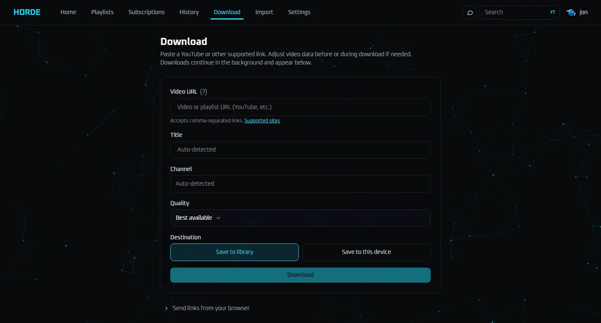
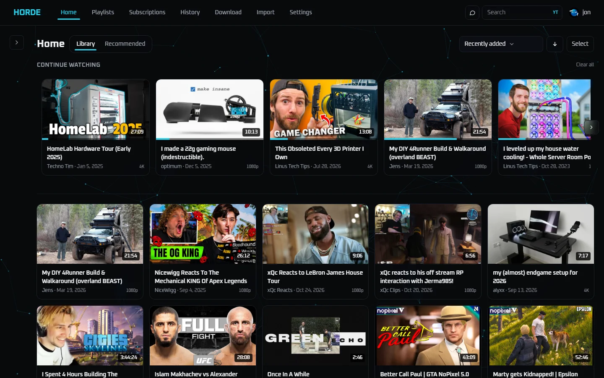
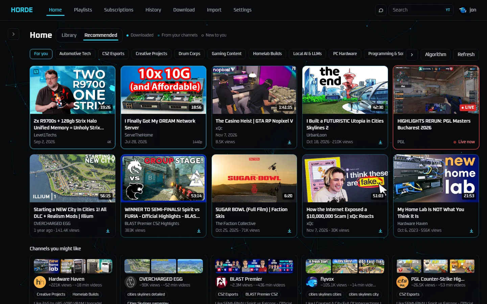
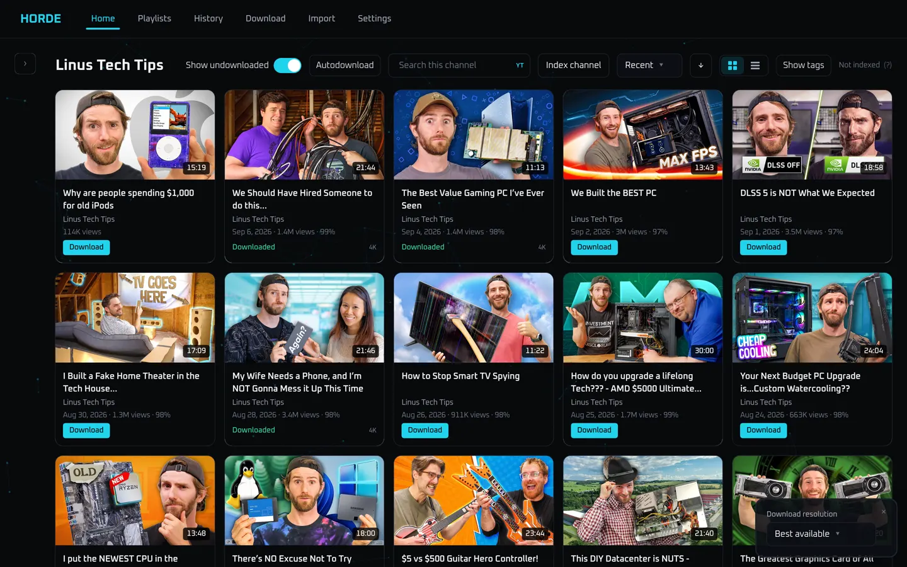
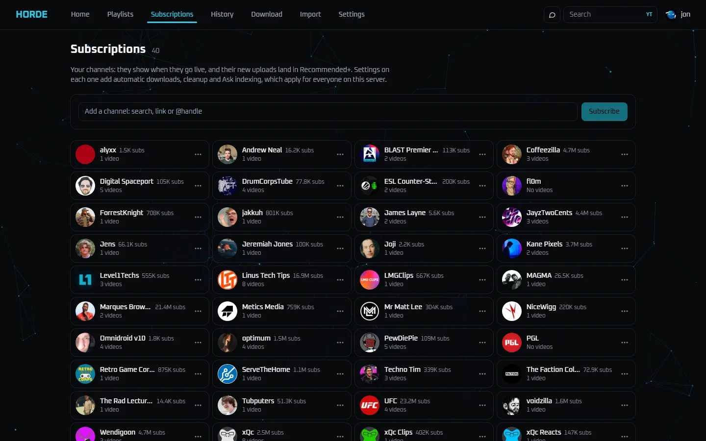
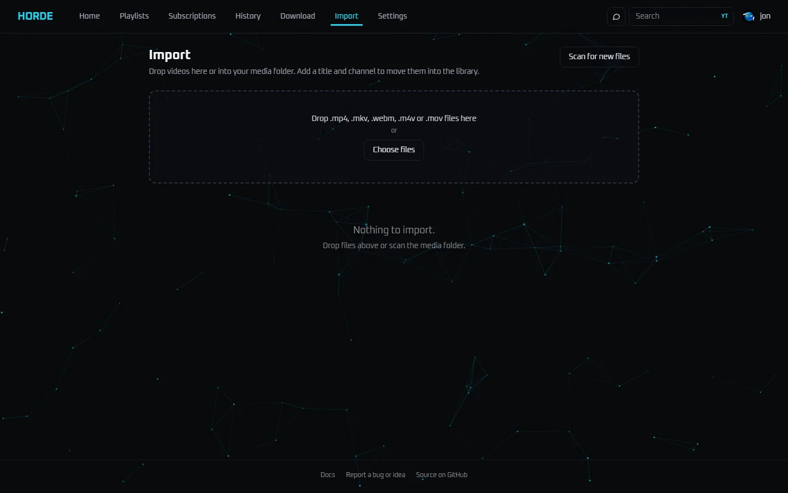
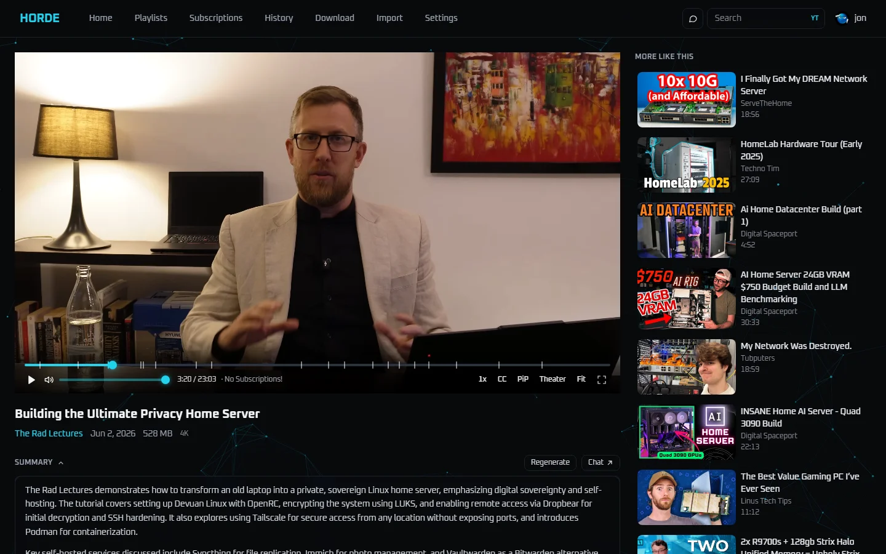
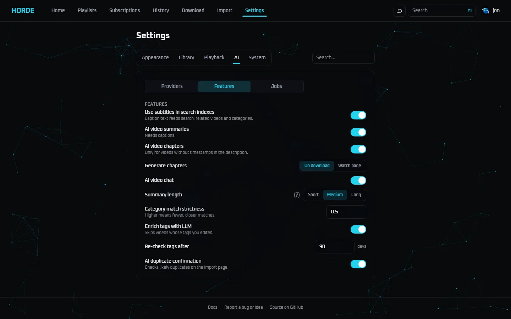

# Features

Everything Horde does, by area. Each section is a tour, not a settings dump: follow the guide links when you need every control. New here? The [home page](index.md) has the short version and the [install steps](getting-started/install-docker.md).

!!! warning "Trusted network"
    Everyone signs in, but Horde is built for a LAN or VPN. To expose it, follow the [internet exposure checklist](ops/internet-exposure.md); do not just port-forward it.

## Where to find things

The top bar has **Home** (the library), **Playlists**, **Subscriptions**, **History**, **Download**, **Import** and **Settings**, plus **Ask** and a search box. The most common tasks:

- **Have Horde do it for you**: **Ask** (top bar) links and changes settings, answers about your own downloads and library with **Use my data** on, offers downloads and playlists, and writes custom CSS you preview first.
- **Find what a channel said**: turn on [Ask](guides/ask.md) for it (Settings → Library → Channels Ask can answer from), then search from the search bar: **Said in videos** lists every moment that mentions your words.
- **Download a video**: open **Download** in the top bar, paste the link, pick a quality and press **Download**.
- **Upgrade a video you have to a higher resolution** (say 1080p to 4K): open it, then **••• → Change resolution** under the player. The file is replaced; no need to delete and download again.
- **Edit a video's title, notes or tags, normalize its volume, save it to this device or delete it**: the same **•••** menu on its watch page.
- **Add files you already have**: **Import**, or drop them in the media folder.
- **Change how Horde looks, downloads and plays**: **Settings → Appearance / Library / Playback**. **AI** and **System** are there for the administrator.

## Downloads

Paste a [yt-dlp](https://github.com/yt-dlp/yt-dlp)-supported URL (YouTube is the well-tested path), pick a quality preset, and watch a FIFO queue with live progress. Pause and resume the queue. YouTube playlists can be imported as individual videos or turned into a Horde playlist.

- **Quality presets** from **best** (highest AV1 when YouTube offers it) through height caps (2160p down to 480p) and audio-only, with a default you choose once. Horde does **not** download YouTube Shorts.
- **Change resolution** later (say 1080p to 4K) from a video's **•••** menu; the file is replaced.
- **Send links from anywhere**: a bookmarklet, and the installed app in Android's share sheet.
- **Clips**: save a part of a live stream, a past stream or a downloaded YouTube video as its own video.
- **Disk limit**: an optional **Max disk usage**; downloads wait at the limit and start again when there is room.
- **Volume normalization** (loudnorm), optional, per video.

Files land as **one original file per video**. The default is **AV1** (copied, remuxed to MP4 + AAC). **Playback compatibility** can instead download YouTube's H.264, convert to H.264, or keep a ≤1080p H.264 copy beside the AV1 original; each device then plays the file it can decode. There is no Plex-style live transcode.

Full guide: [Downloads](guides/downloads.md).

## On disk

Library identity is the relative media path:

`Channel/Year/Title [id].ext`

That tree is what you see over SMB, and it matches the UI. Sidecar thumbnails, subtitles, and sprites live beside the file. Dropped files on the share show up in Import within the scan interval (default 60s). An off-by-default setting also writes the `.nfo` and artwork files [Jellyfin, Kodi and Plex](guides/media-servers.md) read.

Why this layout: [Channel/year layout](design/channel-year-layout.md). Storage map: [Storage layout](ops/storage-layout.md).

## Library

The home screen is a video grid (or channel feed), a channel sidebar, search, tags, sorting, and bulk actions.

- **Channel sidebar**: filter by creator; search local channels and discover remote YouTube channels
- **Search**: titles, descriptions, captions and saved comments, with results from your library and from YouTube side by side
- **Sort**: recently added, publish date, title, duration, size, views, or random (session override lasts 3 hours)
- **Tags**: chips from downloads, manual edits, or AI enrich
- **Select mode**: click, Shift-click ranges, then bulk add-to-playlist, notes, resync, download, or delete
- **Continue watching**: in-progress row on the home Library tab (7-day window)
- **Trash**: a deleted video stays restorable for 7 days, with its tags, progress and playlist places

Full guide: [Library](guides/library.md). Search behavior: [Search](guides/search.md).

## Recommended

The second home tab, for when you don't know what to watch: new uploads from your channels, more like what you have been watching, channels you have never seen (found on YouTube in the background) and the odd throwback. It works without AI and gets sharper with it.

- **Continue watching** here also carries streams you left part-way and videos you watched on YouTube lately
- **Algorithm**, above the feed, opens every weight behind it; **Not interested** and channel suggestions steer it
- A card's outline says where it comes from: downloaded, from a channel you subscribe to, or new to you

Details: [Library and Recommended](guides/library.md#library-and-recommended).

## Channels and subscriptions

Open a channel from the sidebar to see its **feed**: videos already in your library, plus optional **undownloaded** catalog entries from YouTube.

- **Subscribe** to a channel (by name, URL or `@handle`, or automatically when you download from it) and choose whether its new uploads download by themselves
- **Retention rules** per channel: keep the newest N, remove videos older than D days; removals go to the trash first
- **Catalogs** are **YouTube-only**. Browse, stream and queue downloads without leaving the feed. Non-YouTube yt-dlp URLs still download; they just do not get a remote catalog

Full guide: [Channels](guides/channels.md).

## Import and review

Bring in files that did not come from the download queue: drag-and-drop on `/import`, or drop `.mp4` / `.mkv` / `.webm` / `.m4v` / `.mov` into the media folder. A review queue asks for a **channel** (and usually a title) before the file joins the library.

**Scan for new files** walks the tree immediately instead of waiting for the watchdog. Skip does not get undone by the background poller; only that button re-queues skipped files.

An existing archive from yt-dlp, Tube Archivist, Pinchflat or another Horde comes in with its metadata, read from the sidecar files: [Moving an existing archive](guides/migrating.md).

Full guide: [Import & review](guides/import-review.md).

## Player

Library watch and streaming share the same player.

| Mode | Behavior |
|------|----------|
| **Standard** | Inline player in the watch layout |
| **Theater** | Wider player, reduced chrome (desktop) |
| **Windowed** | Immersive layout, page scroll locked (desktop) |

Also: mini player, PiP, Chromecast / AirPlay, SponsorBlock, chapters (description, yt-dlp, or optional AI), draggable VTT subtitles, seek previews, hold-to-2×, a session play queue, autoplay of related videos or the next part of a series, and hotkeys you can rebind. Videos play without YouTube's ads. Under the video, YouTube's top comments are saved with it, popular discussions included, and count in search and in Ask's answers about the video ([Comments](guides/comments.md)). Mobile forces standard mode.

Keyboard shortcuts live in the [player guide](guides/player.md) and the [shortcuts reference](reference/keyboard-shortcuts.md). Watch/resume behavior: [Watching](guides/watching.md). On a TV: [Watch on your TV](guides/tv.md).

## Streaming without downloading

You can play a remote YouTube URL in the same shell (`/watch?url=…`) before committing disk. Adaptive DASH when available. A streamed video resumes where your account left it, counts in History and Recommended, and gets comments, seek previews and the AI panel. This path is **somewhat fragile** and quality can vary from video to video: stream, then download what is worth keeping. When a download started from a stream **completes**, Horde hands off to the local file and keeps your place where it can.

## Live streams

A small **Live** list in the sidebar shows which subscribed channels are live, with title and game. A channel's page leads with its current broadcast, and its **Live** tab lists past streams to watch or download (with a storage warning for streams over two hours). Live streams play through a server-side HLS proxy that refreshes YouTube's URLs on its own, and you can scrub back up to 4 hours by default. Toggle it in **Settings → Library → Show live streams**. Details: [Live streams](design/live-streams.md).

## Playlists

Create your own lists, import a YouTube playlist in one shot, or **subscribe** so new parts append on a schedule (about hourly). Sync never deletes files. A playlist can hold videos that are not downloaded, and is **App-wide** or private to its owner. Add videos from the playlist page, from library bulk select, or from recent downloads.

Full guide: [Playlists](guides/playlists.md).

## History and YouTube history

History lists what you watched, downloaded or streamed, with a stats band of your own watch time. Import your YouTube watch history, subscriptions and playlists from a Google Takeout export, each person for their own account. Videos you watched on YouTube get a **Watched** badge on channel pages and count as seen in **Recommended**, the channels you watch there steer recommendations (recent viewing far more than old, with the odd **Throwback**), and the Download page suggests what you rewatch most. Import a newer export any time; only new views are added.

Full guides: [History](guides/history.md), [YouTube history](guides/youtube-history.md).

## Accounts and household

One administrator plus as many members as you like. Each account has its own watch history, recommendations, AI chats, playlists and appearance.

- **Permissions**: the administrator decides what each member may do, such as download, delete, manage subscriptions or use AI
- **Invite links**: send a one-time link instead of choosing someone's password
- **Parental controls**: limit a member to chosen channels; the server enforces it everywhere, links included
- **Two-step sign-in** with an authenticator app, a list of signed-in devices, and password reset through the server log

Details: [Accounts and sign-in](ops/authentication.md).

## Phones and offline

Install Horde to a phone's home screen: it gets a tab bar at the bottom and, on Android, a share-sheet entry. Save videos to the device and watch them without a connection (needs HTTPS).

Full guide: [Offline & installed app](guides/offline.md).

## Ask and optional AI

Turn the archive into something you can actually ask questions of. Use any OpenAI-compatible provider: a cloud one such as **OpenRouter** (often cheaper and lower maintenance for this app), a server you run such as **Ollama** or LM Studio, or a cloud model for chat with local embeddings.

| Feature | Needs |
|---------|--------|
| Hybrid search (keyword + embeddings) | Embed indexes |
| Related videos on Watch | Embeddings |
| Recommended category shelves | Embeddings + categories |
| Recommended (mixed feed with channels new to you) | Works without AI; embeddings make it much sharper; a chat model writes better searches |
| Summaries, chapters, tag enrich, Ask about a video (**Chat** under it) | Chat LLM |
| Duplicate help on Import | Chat (optional embed similarity) |
| [Ask](guides/ask.md): search what channels said, and ask them (or one video) questions with references to the moment | Search works without AI; asking needs a chat model; embeddings help it find meaning |
| Ask about Horde itself: how-tos, finding and changing settings, your own library, custom CSS | Without AI it shows the matching documentation; with a chat model it answers and acts after you confirm |

Until providers are ready, search is keyword-only. Workload profiles keep a small GPU from getting thrashed.

Setup: [AI setup](ops/ai-setup.md). What each feature does: [AI features](guides/ai-features.md). Local vs cloud: [Local vs cloud AI](design/local-vs-cloud-ai.md).

## Appearance

Thirteen built-in themes (nine dark, four light) plus your own colours, a choice of fonts, background effects such as the constellation, panel transparency and custom CSS with saved themes. Each account keeps its own look.

None of it needs coding. Nearly everything is a setting, and for the rest you describe what you want to [Ask](guides/ai-features.md#custom-css) ("rounder video cards", "hide the channel sidebar"): it writes the CSS and previews it on the page before you keep it.

Details: [Appearance](settings/appearance.md), [Custom CSS](settings/custom-css.md).

## Running it

- **One container**: API, React UI, and this wiki ship in a single image, for x86 and ARM. Host port **8686** maps to container **8080**
- **Updates**: **Settings → System → Updates → Update now**, or `bash update.sh`. Each update backs up the database and rolls back if the new version does not start ([Updating](getting-started/updating.md))
- **Notifications** to ntfy, Discord or any webhook when a download fails, the queue pauses or an update rolls back ([Notifications](ops/notifications.md))
- **Backups**, storage and background activity on **Settings → System** ([System](settings/system.md), [Backup & restore](ops/backup-restore.md))

Full docs in a running instance: **Settings → System → Documentation**, or `/wiki/`. Interactive API: `/docs`.

Next: clone and [install with Docker](getting-started/install-docker.md), or [TrueNAS / Dockge](getting-started/truenas-dockge.md) from zero.
