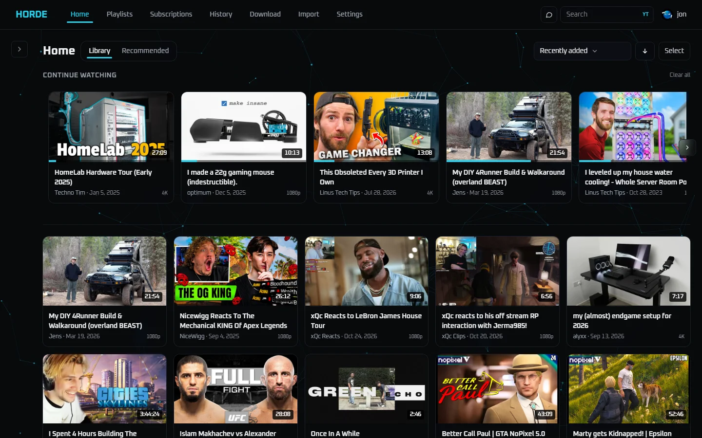
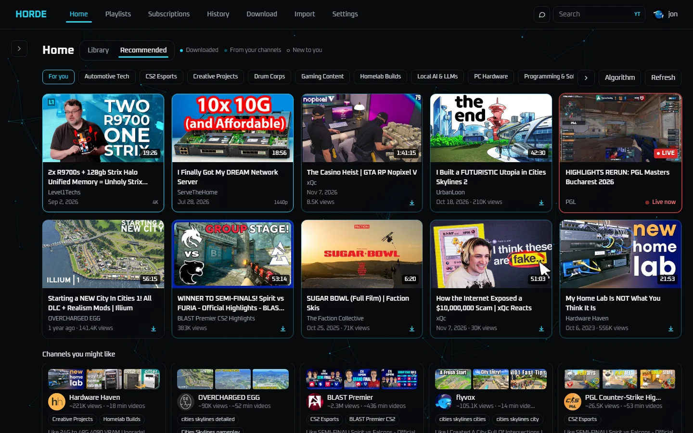
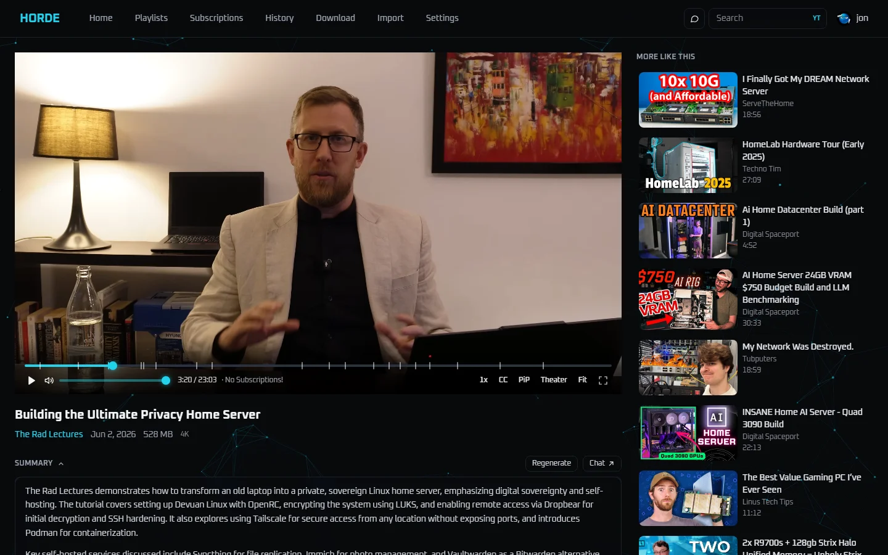
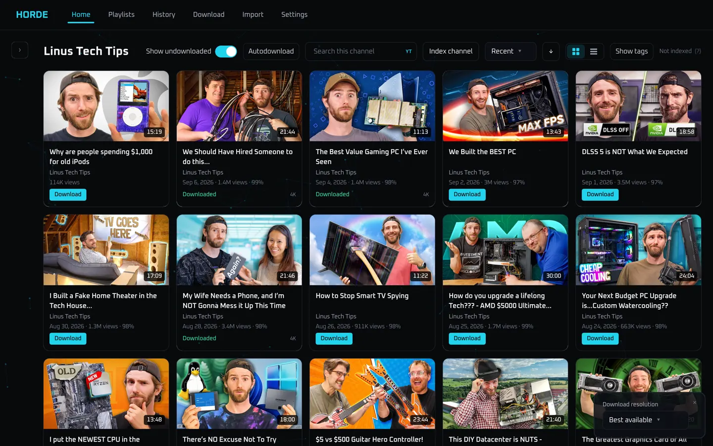
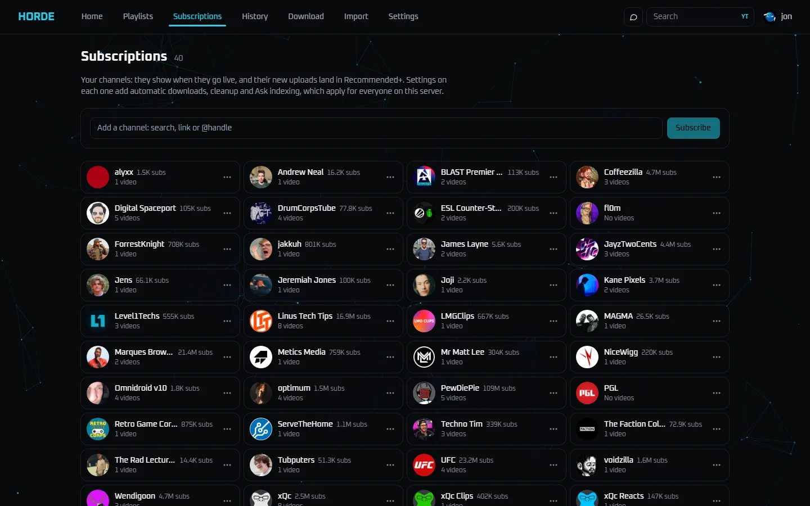
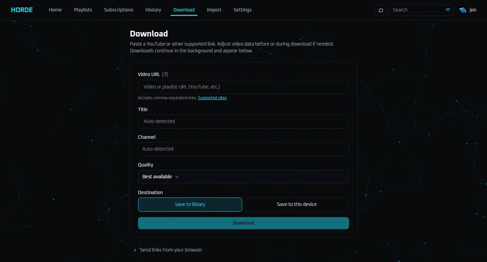

<div class="horde-home" markdown>

<section class="horde-hero" markdown>

<h1 class="horde-hero__title">Self-hosted media archive, downloader, and player</h1>

<p class="horde-hero__lede">Deploy with Docker and watch anywhere</p>

<div class="horde-hero__actions" markdown>
[Install with Docker](getting-started/install-docker.md){ .md-button .md-button--primary }
[Features](features.md){ .md-button }
[Read the docs](#documentation){ .md-button }
</div>

</section>

<div class="horde-screens">
  <input class="horde-screens__pick" type="radio" name="horde-screen" id="screen-library" checked>
  <input class="horde-screens__pick" type="radio" name="horde-screen" id="screen-recommended">
  <input class="horde-screens__pick" type="radio" name="horde-screen" id="screen-player">
  <input class="horde-screens__pick" type="radio" name="horde-screen" id="screen-channel">
  <input class="horde-screens__pick" type="radio" name="horde-screen" id="screen-subscriptions">
  <input class="horde-screens__pick" type="radio" name="horde-screen" id="screen-downloads">
  <div class="horde-screens__tabs">
    <label for="screen-library">Library</label>
    <label for="screen-recommended">Recommended</label>
    <label for="screen-player">Player</label>
    <label for="screen-channel">Channel</label>
    <label for="screen-subscriptions">Subscriptions</label>
    <label for="screen-downloads">Download</label>
  </div>
  <div class="horde-screens__stage">
    <figure class="horde-screens__shot horde-screens__shot--library">
      
      <figcaption>Your library, with the videos you left part-way at the top.</figcaption>
    </figure>
    <figure class="horde-screens__shot horde-screens__shot--recommended">
      
      <figcaption>Recommended mixes new uploads, more of what you watch and channels new to you. Every setting behind it is yours to tune.</figcaption>
    </figure>
    <figure class="horde-screens__shot horde-screens__shot--player">
      
      <figcaption>The player, with chapters on the seek bar, a summary and related videos.</figcaption>
    </figure>
    <figure class="horde-screens__shot horde-screens__shot--channel">
      
      <figcaption>A channel page shows what you have next to what you could stream or download.</figcaption>
    </figure>
    <figure class="horde-screens__shot horde-screens__shot--subscriptions">
      
      <figcaption>Subscribe to a channel and its new uploads download by themselves.</figcaption>
    </figure>
    <figure class="horde-screens__shot horde-screens__shot--downloads">
      
      <figcaption>Paste a link, pick a quality, and follow the queue.</figcaption>
    </figure>
  </div>
</div>

<section class="horde-section" markdown>

## Just ask { #ask }

**Ask** is a chat box on every page, and the quickest way to do most things in Horde. Say what you want in plain words:

- *"Make the video cards rounder and hide the channel sidebar."* It writes the CSS, previews it on the page, and keeps it only if you like it.
- *"Turn on SponsorBlock."* *"Make the text bigger."* It finds the setting and changes it once you confirm.
- *"What does The Car Care Nut say about the 2004 4Runner?"* It answers from what the channel said in its videos, with a link to the moment for every point.
- *"What is this video about?"* *"Why did my last download fail?"* *"Make a playlist of the cooking videos."*

Asking needs an AI model, from a cloud provider or one you run yourself. Without one, Ask still shows the documentation page that answers your question, and search still finds every moment a channel mentioned your words. [Ask](guides/ask.md), [what it can do](guides/ai-features.md#ask)

</section>

<section class="horde-section" markdown>

## What Horde does { #what-horde-does }

<div class="horde-features" markdown>

<div class="horde-feature" markdown>
### Ask, and optional AI
One chat on every page that changes settings for you, restyles the app, and answers "what did this channel say about…" with links to the moment. Plus summaries and chapters. Use a cloud provider or your own Ollama, or leave it off. [Ask](guides/ask.md), [AI features](guides/ai-features.md)
</div>

<div class="horde-feature" markdown>
### Download
Paste a link from YouTube or any other [yt-dlp](https://github.com/yt-dlp/yt-dlp) site, pick a quality up to 4K, and follow a live queue. Whole playlists too, and a share-sheet entry to send links from your phone. [Downloads](guides/downloads.md)
</div>

<div class="horde-feature" markdown>
### Subscribe
Subscribe to channels and their new uploads arrive on their own. Keep everything, or only the newest few. [Channels](guides/channels.md#subscriptions)
</div>

<div class="horde-feature" markdown>
### Stream first
Watch a YouTube video or a live broadcast without downloading it, then keep it if it was worth it. Live streams rewind up to four hours. [Watching](guides/watching.md)
</div>

<div class="horde-feature" markdown>
### Find it again
A channel sidebar, tags, and search across titles, descriptions, captions and saved comments. [Library](guides/library.md), [Search](guides/search.md)
</div>

<div class="horde-feature" markdown>
### Know what to watch
A Recommended feed of new uploads, more of what you watch and channels you have not seen, with every weight open to change. [Library and Recommended](guides/library.md#library-and-recommended)
</div>

<div class="horde-feature" markdown>
### A real player
Theater and mini player, picture-in-picture, chapters, subtitles, SponsorBlock, rebindable hotkeys, Chromecast and AirPlay. No YouTube ads. [Video player](guides/player.md)
</div>

<div class="horde-feature" markdown>
### For the whole household
One administrator and as many members as you like, each with their own history, recommendations and look. Invite by link, choose what each person may do, and limit a child's account to chosen channels. [Accounts](ops/authentication.md)
</div>

<div class="horde-feature" markdown>
### On your phone and TV
Installs as an app, saves videos to the device for offline viewing, and casts to a TV. It can also write the files Jellyfin, Kodi and Plex read. [Offline](guides/offline.md), [TV](guides/tv.md)
</div>

<div class="horde-feature" markdown>
### Bring what you have
Point Horde at an archive from yt-dlp, Tube Archivist, Pinchflat or another Horde, and import your YouTube history from Google Takeout. [Moving an archive](guides/migrating.md)
</div>

<div class="horde-feature" markdown>
### Make it yours
No coding needed. Thirteen themes, your own colours and fonts, background effects, and nearly everything is a setting. For the rest, describe the look you want to Ask and it writes the custom CSS for you. [Appearance](settings/appearance.md), [Custom CSS](settings/custom-css.md)
</div>

<div class="horde-feature" markdown>
### Looks after itself
Update from a button in the app. Each update backs up the database first and rolls back if the new version does not start. [Updating](getting-started/updating.md)
</div>

</div>

[The full feature list](features.md){ .md-button }

</section>

<section class="horde-section" markdown>

## Install { #install }

Horde is one Docker container. On a Linux host with Docker and Git:

```bash
git clone https://github.com/jm-connell/horde.git && cd horde
git checkout -B horde-release "$(git describe --tags --abbrev=0 --match 'v[0-9]*' --exclude '*-*')"   # newest release
cp .env.example .env    # set PUID, PGID, DOWNLOADS_PATH and DATA_PATH
docker compose up -d
```

Open `http://<server-ip>:8686`, create the administrator account, and the setup wizard does the rest. Compose downloads the published image for x86 or ARM; nothing is built on your machine.

<div class="horde-platforms" markdown>
[Step by step with Docker](getting-started/install-docker.md)
[TrueNAS / Dockge](getting-started/truenas-dockge.md)
[Windows](getting-started/other-platforms.md#windows)
[macOS](getting-started/other-platforms.md#macos)
[Raspberry Pi](getting-started/other-platforms.md#raspberry-pi)
[Unraid](getting-started/other-platforms.md#unraid)
[Synology](getting-started/other-platforms.md#synology-container-manager)
[Portainer](getting-started/other-platforms.md#portainer)
[Proxmox](getting-started/other-platforms.md#proxmox)
</div>

!!! warning "Built for a trusted network"
    Everyone signs in ([accounts](ops/authentication.md)), but Horde is made for a home network or a VPN such as Tailscale. To reach it from the internet, follow the [internet exposure checklist](ops/internet-exposure.md) first.

After it is running: [First run](getting-started/first-run.md) walks through the setup wizard and your first download.

</section>

<section class="horde-section" markdown>

## Documentation { #documentation }

Everything is documented here, and the same pages ship inside every Horde at `/wiki/` (**Settings → System → Documentation**). Search is in the bar at the top.

<div class="horde-docs" markdown>

<div class="horde-docs__group" markdown>
### Getting started
- [Install with Docker](getting-started/install-docker.md)
- [TrueNAS / Dockge](getting-started/truenas-dockge.md)
- [Other platforms](getting-started/other-platforms.md)
- [First run](getting-started/first-run.md)
- [Updating](getting-started/updating.md)
</div>

<div class="horde-docs__group" markdown>
### Using Horde
- [Library](guides/library.md) and [search](guides/search.md)
- [Downloads](guides/downloads.md) and [channels](guides/channels.md)
- [Watching](guides/watching.md) and the [player](guides/player.md)
- [Playlists](guides/playlists.md) and [history](guides/history.md)
- [Import & review](guides/import-review.md)
- [Offline & installed app](guides/offline.md)
- [Ask](guides/ask.md) and [AI features](guides/ai-features.md)
</div>

<div class="horde-docs__group" markdown>
### Settings
- [Overview](settings/index.md)
- [Appearance](settings/appearance.md) and [custom CSS](settings/custom-css.md)
- [Library](settings/library.md)
- [Playback](settings/playback.md)
- [AI](settings/ai.md)
- [System](settings/system.md)
</div>

<div class="horde-docs__group" markdown>
### Running it
- [Accounts & sign-in](ops/authentication.md)
- [Remote access](ops/remote-access.md)
- [Backup & restore](ops/backup-restore.md)
- [AI setup](ops/ai-setup.md)
- [Notifications](ops/notifications.md)
- [Environment variables](ops/environment.md)
- [Troubleshooting](ops/troubleshooting.md)
</div>

<div class="horde-docs__group" markdown>
### Reference
- [FAQ](reference/faq.md)
- [Keyboard shortcuts](reference/keyboard-shortcuts.md)
- [Glossary](reference/glossary.md)
- [Storage layout](ops/storage-layout.md)
- [Security](ops/security.md)
</div>

<div class="horde-docs__group" markdown>
### Under the hood
- [Architecture map](design/architecture.md)
- [API overview](architecture/api-overview.md)
- [Decision records](adr/index.md)
- [Why Horde](design/why-horde.md)
- [Local development](getting-started/local-dev.md)
</div>

</div>

</section>

<section class="horde-section" markdown>

## Is it for you? { #is-it-for-you }

Horde is a good fit when you want to **keep** videos: channels you subscribe to, talks and tutorials you return to, things that may disappear. A few neighbours, in short:

| If you want… | Consider |
|--------------|----------|
| A YouTube archive with a library and player in one container, plus optional AI | **Horde** |
| A YouTube archive built around Elasticsearch, with its own browser extension | [Tube Archivist](https://www.tubearchivist.com/) |
| A downloader that feeds Plex or Jellyfin and has no player of its own | [Pinchflat](https://github.com/kieraneglin/pinchflat) |
| Films and TV series with apps on every TV | Jellyfin or Plex (Horde can [feed them](guides/media-servers.md) its videos too) |

</section>

<section class="horde-section horde-about" markdown>

<div markdown>
## About { #about }

Horde started as one person's answer to a gap in Plex: it handles films and TV well, but not the long tail of "other" video worth keeping. It is built for a homelab first (TrueNAS with Dockge, a single container, files that still make sense over SMB) and has grown accounts, subscriptions, streaming and an optional AI layer since.

It was written with AI coding assistants, and most of this documentation was too; every change has to pass an automated test suite of the API, the interface and the docs build ([how Horde is built](design/vibecoded.md), [why Horde](design/why-horde.md)). Horde follows tagged releases ([changelog](https://github.com/jm-connell/horde/blob/main/CHANGELOG.md)).
</div>

<div markdown>
## Help and license { #help }

- **Ask**, in the top bar of every Horde, answers from this documentation. With AI it writes the answer; without, it shows the matching pages.
- [Troubleshooting](ops/troubleshooting.md) and the [FAQ](reference/faq.md) cover the common problems.
- Bugs and ideas go to [GitHub issues](https://github.com/jm-connell/horde/issues); security problems, [privately](https://github.com/jm-connell/horde/security/advisories/new).
- Horde is free and source-available under the **PolyForm Noncommercial License 1.0.0**: personal and other noncommercial use is allowed, selling it is not ([FAQ](reference/faq.md#what-license-is-horde-under)). If you enjoy it, you can [sponsor its development](https://github.com/sponsors/jm-connell).
</div>

</section>

</div>
