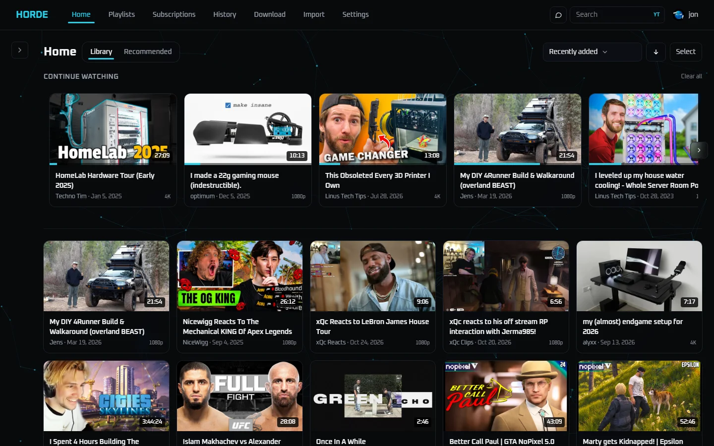

# Horde

**Horde is a self-hosted library for the videos you want to keep.** Download from YouTube or any other [yt-dlp](https://github.com/yt-dlp/yt-dlp) site, follow channels so new uploads arrive by themselves, bring in files you already have, and watch it all in a clean player on your desktop, phone or TV. Your videos stay plain files on your own disk (`Channel/Year/Title [id].mp4`), readable without Horde.



[Install with Docker](getting-started/install-docker.md){ .md-button .md-button--primary } [TrueNAS / Dockge](getting-started/truenas-dockge.md){ .md-button } [Unraid, Synology, Portainer](getting-started/other-platforms.md){ .md-button }

## Quick start

On a Linux host with Docker and Git:

```bash
git clone https://github.com/jm-connell/horde.git && cd horde
cp .env.example .env    # set PUID, PGID, DOWNLOADS_PATH and DATA_PATH
docker compose up -d
```

Open `http://<server-ip>:8686`, create the administrator account, and the setup wizard does the rest. Step by step, with checks along the way: [Install with Docker](getting-started/install-docker.md).

!!! warning "Trusted network"
    Everyone signs in ([accounts](ops/authentication.md)), but Horde is built for a home network or a VPN such as Tailscale. To reach it from the internet, follow the [internet exposure checklist](ops/internet-exposure.md) first.

## What it does

| Area | What you get |
|------|--------------|
| **Downloads** | Paste any yt-dlp link, pick a quality, follow a live queue. Whole playlists, and a bookmarklet or share-sheet entry to send links from your phone |
| **Subscriptions** | Follow channels, download their new uploads automatically, keep only the latest N ([Channels](guides/channels.md#subscriptions)) |
| **Your existing archive** | Point Horde at folders from yt-dlp, Tube Archivist, Pinchflat or another Horde; it reads their sidecar files ([Moving an existing archive](guides/migrating.md)) |
| **Library** | Channel sidebar, search across titles, descriptions and captions, tags, continue watching, recommendations |
| **Player** | Theater and mini player, picture-in-picture, chapters, subtitles, SponsorBlock, Chromecast and AirPlay ([Watch on your TV](guides/tv.md)) |
| **Household** | One administrator and as many members as you like, each with their own history and look, invited with a link |
| **Phones** | Installs as an app, keeps videos for offline viewing |
| **AI (optional)** | Summaries, chapters, chat about a video, smarter search and "what did this channel say about…", with any OpenAI-compatible provider or your own Ollama |
| **YouTube streaming** | Preview a video before deciding to download it. It works for most videos, but quality varies and it can break when YouTube changes |

Every video watched in Horde plays without YouTube's ads, and [SponsorBlock](https://github.com/ajayyy/SponsorBlock) can skip the sponsor segments baked into them. The [feature overview](features.md) has screenshots of each screen.

## Is it for you?

Horde is a good fit when you want to **keep** videos: channels you follow, talks and tutorials you return to, things that may disappear. A few neighbours, in short:

| If you want… | Consider |
|--------------|----------|
| A YouTube archive with a library and player in one container, plus optional AI | **Horde** |
| A YouTube archive built around Elasticsearch, with its own browser extension | [Tube Archivist](https://www.tubearchivist.com/) |
| A downloader that feeds Plex or Jellyfin and has no player of its own | [Pinchflat](https://github.com/kieraneglin/pinchflat) |
| Films and TV series with apps on every TV | Jellyfin or Plex (Horde can [feed them](guides/media-servers.md) its videos too) |

## Where to start

1. [Install](getting-started/install-docker.md) (or [TrueNAS / Dockge](getting-started/truenas-dockge.md), or [another platform](getting-started/other-platforms.md))
2. [First run](getting-started/first-run.md): the setup wizard, your first download, and **Get started** on the empty library
3. [Moving an existing archive](guides/migrating.md), if you already have videos
4. [Updating](getting-started/updating.md): the **Update now** button, or `bash update.sh`
5. [AI setup](ops/ai-setup.md), whenever you want it

## Getting help

- **Ask**, at the bottom of every page, answers from this documentation (with AI it writes the answer; without, it shows the matching pages).
- [Troubleshooting](ops/troubleshooting.md) and the [FAQ](reference/faq.md) cover the common problems.
- Bugs and ideas: **Report a bug or idea** in Horde's footer opens a [GitHub issue](https://github.com/jm-connell/horde/issues) with your version filled in. Security problems: [report them privately](https://github.com/jm-connell/horde/security/advisories/new).

This wiki is also built into every Horde at `/wiki/` (**Settings → System → Documentation**), and the API reference is at `/docs`.

## About

Horde started as one person's answer to a gap in Plex: it handles films and TV well, but not the long tail of "other" video worth keeping. It is built for a homelab first (TrueNAS with Dockge, a single container, files that still make sense over SMB) and has grown accounts, subscriptions and an optional AI layer since. It was written with AI coding assistants, and most of this documentation was too; every change to the code has to pass an automated test suite of the API, the interface and the docs build ([how Horde is built](design/vibecoded.md), [why Horde](design/why-horde.md)).

Horde follows tagged releases ([changelog](https://github.com/jm-connell/horde/blob/main/CHANGELOG.md)), and updates back up the database and roll back by themselves if the new version does not start.

## License

Horde is source-available under the **PolyForm Noncommercial License 1.0.0**. Personal and other noncommercial use is allowed; selling Horde or using it commercially is not. The legal text is `LICENSE` at the repository root. See the [FAQ](reference/faq.md#what-license-is-horde-under).
